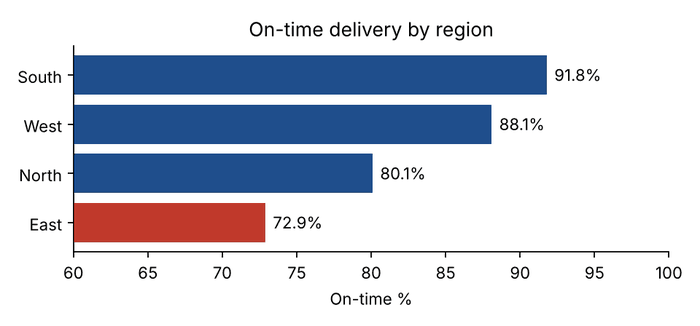
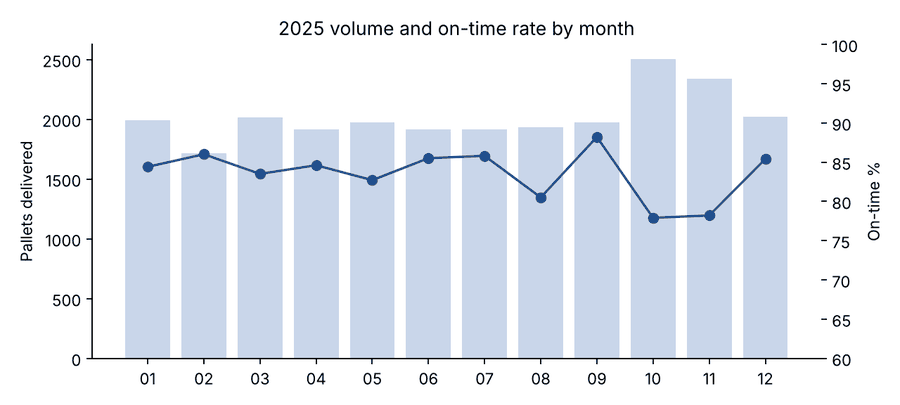

# Logistics Delivery Performance: SQL Analysis


A year of pallet deliveries from four regional warehouses, analysed in SQL to answer the questions an operations manager asks every month: which region is slipping, why, and which customers feel it.

The scenario comes from my time coordinating deliveries with four regional warehouse managers (North, South, East, West), when I tracked 500 to 600 pallet deliveries a month in Excel. This project redoes that analysis properly in SQL.

> The data is synthetic, generated by `generate_data.py` with a fixed seed. No real company data is used.

## Questions and answers

| Question | Answer from the data |
| --- | --- |
| How did we do overall? | 6,938 deliveries, 24,218 pallets, 83.3% on time |
| Which region needs attention first? | East, at 72.9% on time, 19 points behind South |
| Why are deliveries late? | Vehicle availability is the top cause in North and East (about a third of late deliveries each) |
| Does peak season hurt? | Yes. Every region drops 5 to 7 points in October and November, when volume rises about 25% |
| Who is affected most? | Ten customers account for the most late pallets; five of them are Retail |





## Recommendation

Fleet capacity in North and East is the first fix: vehicle availability causes a third of their late deliveries, and they are the two weakest regions both in peak season and the rest of the year. Booking extra vehicles for those two warehouses before October would address the largest share of late pallets.

## SQL used

Each file in [`sql/`](sql) answers one question. Techniques used:

- A view (`v_delivered`) that joins three tables and calculates lateness once
- Window functions: `RANK()`, `ROW_NUMBER()`, `LAG()`, and `SUM() OVER (PARTITION BY ...)`
- CTEs for multi-step logic
- Conditional aggregation for peak vs rest-of-year comparison
- `HAVING` to keep only customers with enough volume to compare

Example, the top late reason in each region:

```sql
WITH reasons AS (
    SELECT region, late_reason, COUNT(*) AS late_count,
           SUM(COUNT(*)) OVER (PARTITION BY region) AS region_late_total
    FROM v_delivered
    WHERE on_time = 0
    GROUP BY region, late_reason
),
ranked AS (
    SELECT *, ROW_NUMBER() OVER (PARTITION BY region ORDER BY late_count DESC) AS rn
    FROM reasons
)
SELECT region, late_reason AS top_reason, late_count,
       ROUND(100.0 * late_count / region_late_total, 1) AS share_of_region_late_pct
FROM ranked
WHERE rn = 1;
```

Full output of every query: [`docs/results.md`](docs/results.md).

## Run it

```sh
pip install -r requirements.txt
python generate_data.py     # writes data/*.csv
python run_analysis.py      # builds delivery.db, writes docs/results.md and charts
pytest -q                   # checks every query runs and returns sane values
```

## Data model

```text
warehouses (warehouse_id, region, city)
customers  (customer_id, segment)
deliveries (delivery_id, warehouse_id, customer_id, planned_date, actual_date,
            pallets, status, late_reason)
```

## Licence

MIT
